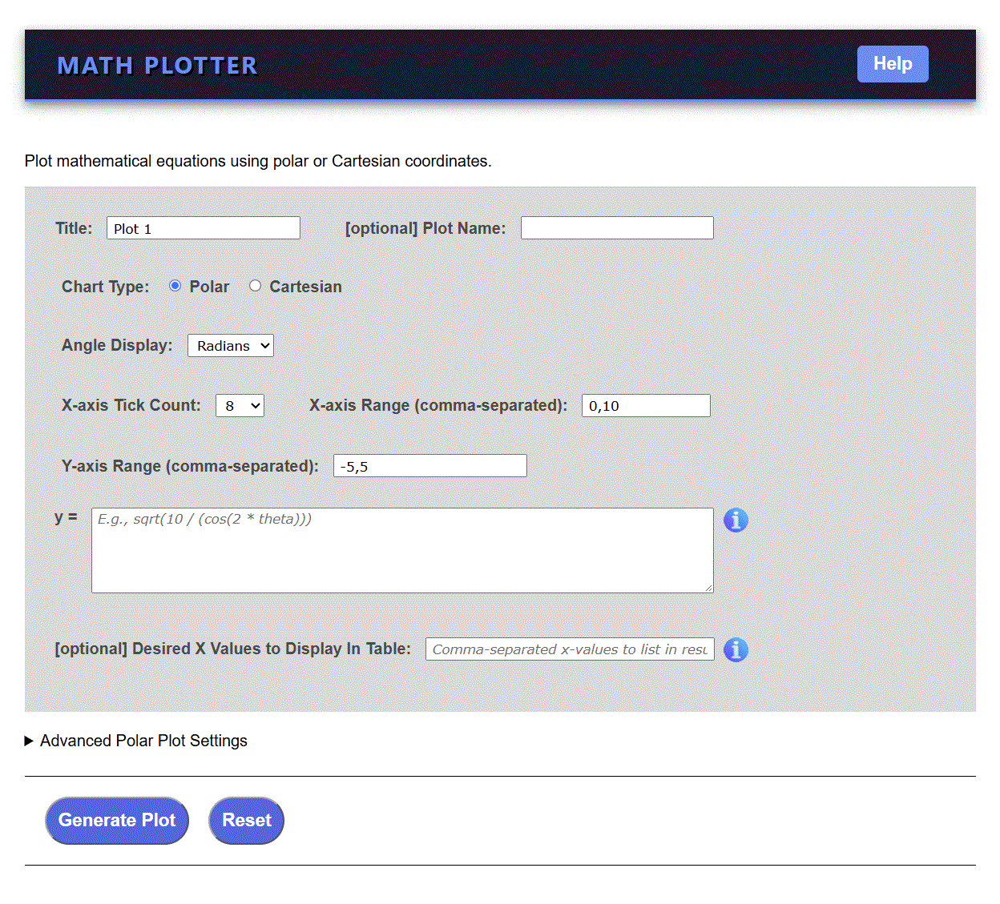
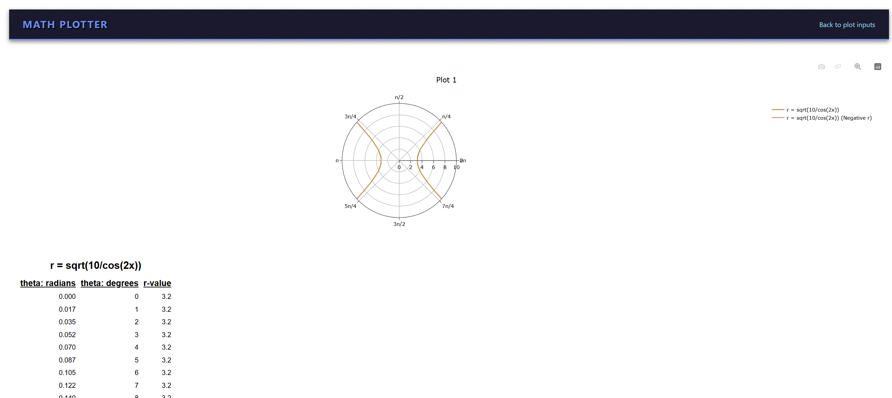
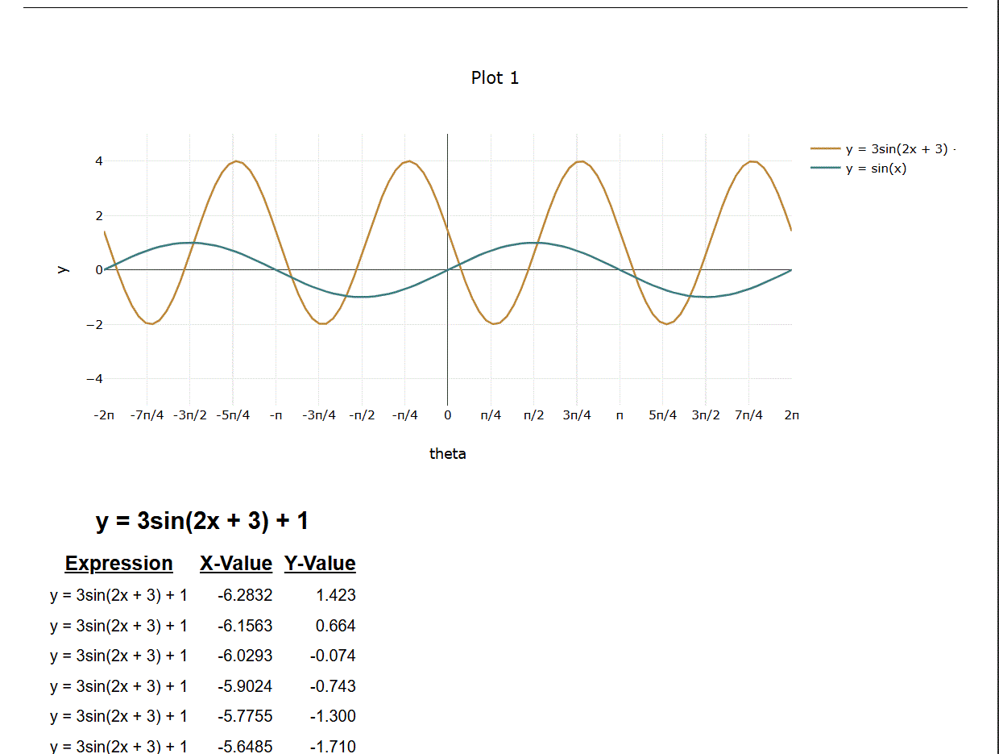

This math function plotter supports both Polar and Cartesian charts. 
Polar charts support both radian and degree axis ticks and values.
Cartesian charts support either X-values being numbers or angles (radian or degrees).
Both charts generate a table of the inputs and corresponding outputs.
For Polar charts, the input is an angular measure and the output is an r-value.
For Cartesian charts, the input is either numeric or angular.
Generated plots and their results tables open in a separate browser tab. Allow popups for this site to use this feature.

More than one equation can be displayed at the same time.  Equations are delimited by a blank line.

The parser currently supports sin, cos, tan, min, max, pow, sqrt and all the basic arithmetic operators and is a good example of such parsers in JavaScript.

### Try It Out!
[Try Math Plotter](https://g2nconnell.github.io/radplot/)

## Screenshots
### Plot Inputs

### Polar Plot

### Cartesian Plot

